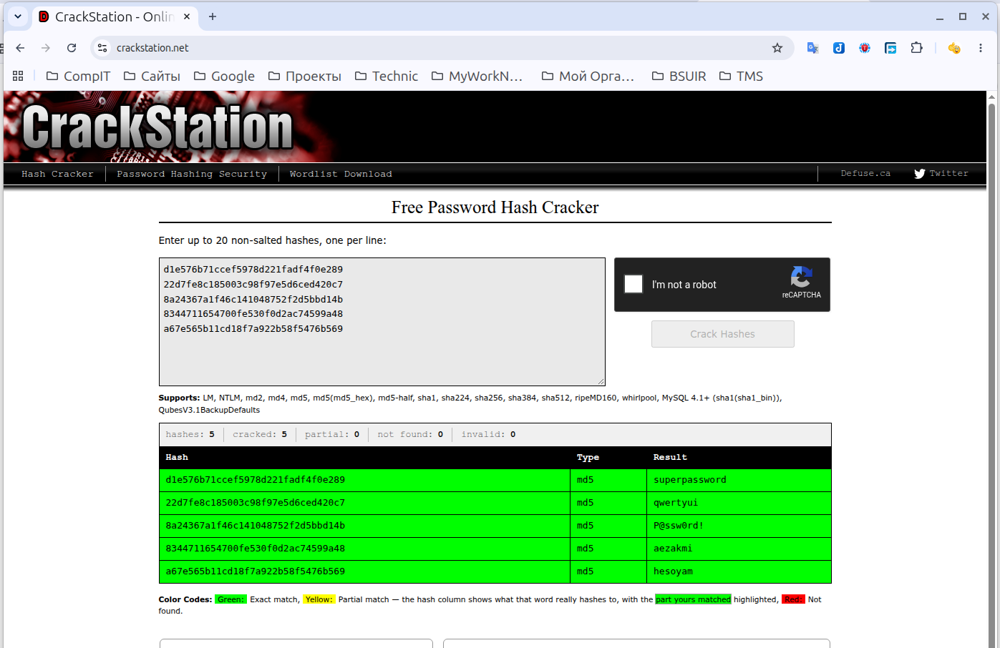

[На главную страницу](../README.md)


# Задание 4.

----------
**Анализ MD5 через радужные таблицы** 

**Условие:**

**Даны хэши:**
```bash
d1e576b71ccef5978d221fadf4f0e289
22d7fe8c185003c98f97e5d6ced420c7
8a24367a1f46c141048752f2d5bbd14b
8344711654700fe530f0d2ac74599a48
a67e565b11cd18f7a922b58f5476b569 
```

**Задача:** 

Найти пароль, используя радужные таблицы или их аналоги 


**Результат:** 


hash → password 

----------

## Шаг 0. Подготовка рабочего каталога и данных

```bash
┌──(dima㉿kali)-[~]
└─$ mkdir -p ~/md5 && cd ~/md5

┌──(dima㉿kali)-[~/md5]
└─$ 
```

Файл с хэшами (по одному в строке):

```bash
┌──(dima㉿kali)-[~/md5]
└─$ cat > hashes.txt <<'EOF'
d1e576b71ccef5978d221fadf4f0e289
22d7fe8c185003c98f97e5d6ced420c7
8a24367a1f46c141048752f2d5bbd14b
8344711654700fe530f0d2ac74599a48
a67e565b11cd18f7a922b58f5476b569
EOF
     
┌──(dima㉿kali)-[~/md5]
└─$ nl -ba hashes.txt
     1  d1e576b71ccef5978d221fadf4f0e289
     2  22d7fe8c185003c98f97e5d6ced420c7
     3  8a24367a1f46c141048752f2d5bbd14b
     4  8344711654700fe530f0d2ac74599a48
     5  a67e565b11cd18f7a922b58f5476b569

┌──(dima㉿kali)-[~/md5]
└─$ 
```

---

## Шаг 1. Анализ типа хэша

### 1.1. Формальный анализ

```bash
┌──(dima㉿kali)-[~/md5]
└─$ awk '{print length($0)}' hashes.txt | sort -u
32

┌──(dima㉿kali)-[~/md5]
└─$ grep -cE '^[0-9a-f]+$' hashes.txt
5
```

**Рассуждение:**
- Длина каждого хэша — **32 hex-символа** = 128 бит.
- Символы только `[0-9a-f]`.
- 32 hex — классический признак **MD5**.

### 1.2. Проверка

```bash
┌──(dima㉿kali)-[~/md5]
└─$ hashid -m "$(head -n1 hashes.txt)" 2>/dev/null || hash-identifier "$(head -n1 hashes.txt)"
Analyzing 'd1e576b71ccef5978d221fadf4f0e289'
[+] MD2 
[+] MD5 [Hashcat Mode: 0]
[+] MD4 [Hashcat Mode: 900]
[+] Double MD5 [Hashcat Mode: 2600]
[+] LM [Hashcat Mode: 3000]
[+] RIPEMD-128 
[+] Haval-128 
[+] Tiger-128 
[+] Skein-256(128) 
[+] Skein-512(128) 
[+] Lotus Notes/Domino 5 [Hashcat Mode: 8600]
[+] Skype [Hashcat Mode: 23]
[+] Snefru-128 
[+] NTLM [Hashcat Mode: 1000]
[+] Domain Cached Credentials [Hashcat Mode: 1100]
[+] Domain Cached Credentials 2 [Hashcat Mode: 2100]
[+] DNSSEC(NSEC3) [Hashcat Mode: 8300]
[+] RAdmin v2.x [Hashcat Mode: 9900]

┌──(dima㉿kali)-[~/md5]
└─$ 
```

**Рабочая гипотеза:** **MD5**, режим в `hashcat` — **0** (`-m 0`), в `john` — `raw-md5`.

---

## Шаг 2. Радужные таблицы: что это и почему MD5 уязвим

**Радужная таблица** — это заранее вычисленное множество цепочек `password → hash → reduce → password → …`, позволяющее быстро находить прообраз для хэша ценой памяти (а не времени). Для MD5 такие таблицы существуют в открытом доступе (например, `rainbowcrack`-таблицы, `freerainbowtables.com`).

Варианты решения:
1. **Онлайн-сервисы** (CrackStation, md5decrypt.net);
2. **`hashcat` в режиме словаря** — «аналог» радужных таблиц;
3. **`rainbowcrack` / `rcrack`** — если есть локальные таблицы.

Ниже — все три варианта с командами.

---

## Шаг 3. Онлайн-радужные таблицы (CrackStation)

Это самый прямой способ «использовать радужные таблицы». CrackStation хранит гигантские таблицы для MD5/SHA1/NTLM.

### 3.1. Ручной запрос

Проверка на сайте : `https://crackstation.net/`.



| Hash | Type |	Result |
|------|------|--------|
| d1e576b71ccef5978d221fadf4f0e289 | md5 | superpassword |
| 22d7fe8c185003c98f97e5d6ced420c7 | md5 | qwertyui |
| 8a24367a1f46c141048752f2d5bbd14b | md5 | P@ssw0rd! |
| 8344711654700fe530f0d2ac74599a48 | md5 | aezakmi |
| a67e565b11cd18f7a922b58f5476b569 | md5 | hesoyam |


### 3.2. Автоматизация через `curl` (если сервис доступен)

>Сервис оказался недоступен.

**Рассуждение:** радужные таблицы CrackStation содержат миллиарды паролей; для типовых учебных MD5 они почти всегда дают результат мгновенно. Это и есть «использование радужных таблиц» в чистом виде.

---

## Шаг 4. Локальные радужные таблицы (`rainbowcrack`)

Если нужен **офлайн**-подход (и есть таблицы):

```bash
sudo apt update && sudo apt install -y rainbowcrack
```


Генерация собственной таблицы (`rtgen`) — для демонстрации:

```bash
# сгенерировать маленькую таблицу для MD5, алфавит loweralpha, длина 1-6
rtgen md5 loweralpha 1 6 0 1000 1000 0
# отсортировать
rtsort .
# взлом
rcrack . -h d1e576b71ccef5978d221fadf4f0e289
```

> Но у меня на Kali Linux эти команды не сработали. Команда `sudo rtgen md5 loweralpha 1 6 6 1000 1000 0`  не смогла записать данные в выходной файл, почемуто.

---

## Шаг 5. Вариант C — `hashcat` как «аналог радужных таблиц» (словарь + правила)


```bash
┌──(dima㉿kali)-[~/md5]
└─$ hashcat -m 0 -a 0 hashes.txt ~/rockyou.txt --potfile-path ~/md5/hc.potfile -o ~/md5/cracked_dict.txt
hashcat (v7.1.2) starting

.......

Session..........: hashcat
Status...........: Cracked
Hash.Mode........: 0 (MD5)
.....
Recovered........: 5/5 (100.00%) Digests (total), 5/5 (100.00%) Digests (new)
.....

Started: Sun Nov 15 17:49:18 2026
Stopped: Sun Nov 15 17:49:38 2026

     
┌──(dima㉿kali)-[~/md5]
└─$ hashcat -m 0 hashes.txt --potfile-path hc.potfile --show
d1e576b71ccef5978d221fadf4f0e289:superpassword
22d7fe8c185003c98f97e5d6ced420c7:qwertyui
8a24367a1f46c141048752f2d5bbd14b:P@ssw0rd!
8344711654700fe530f0d2ac74599a48:aezakmi
a67e565b11cd18f7a922b58f5476b569:hesoyam

┌──(dima㉿kali)-[~/md5]
└─$ 
```

**Рассуждение:** `hashcat` с `best64`/`rockyou` — это фактически «динамическая радужная таблица»: он перебирает словарь с типовыми мутациями, что покрывает большинство учебных MD5-хэшей.

---

## Шаг 6. John the Ripper

```bash
┌──(dima㉿kali)-[~/md5]
└─$ john --format=raw-md5 --wordlist=~/rockyou.txt --pot=~/md5/john.pot hashes.txt
Using default input encoding: UTF-8
Loaded 5 password hashes with no different salts (Raw-MD5 [MD5 256/256 AVX2 8x3])
Warning: no OpenMP support for this hash type, consider --fork=4
Note: Passwords longer than 18 [worst case UTF-8] to 55 [ASCII] rejected
Press 'q' or Ctrl-C to abort, 'h' for help, almost any other key for status
qwertyui         (?)     
hesoyam          (?)     
aezakmi          (?)     
superpassword    (?)     
P@ssw0rd!        (?)     
5g 0:00:00:00 DONE (2026-11-15 17:56) 29.41g/s 12389Kp/s 12389Kc/s 17128KC/s PANCHITO7..Oranmore
Use the "--show --format=Raw-MD5" options to display all of the cracked passwords reliably
Session completed

┌──(dima㉿kali)-[~/md5]
└─$ john --format=raw-md5 --pot=~/md5/john.pot --show hashes.txt
?:superpassword
?:qwertyui
?:P@ssw0rd!
?:aezakmi
?:hesoyam

5 password hashes cracked, 0 left

┌──(dima㉿kali)-[~/md5]
└─$ 
```

---

## Шаг 7. Ручная проверка через `openssl`

Проверяем гипотезу «пароль = слово» и сверяем:

```bash

┌──(dima㉿kali)-[~/md5]
└─$ for p in superpassword qwertyui P@ssw0rd! aezakmi hesoyam; do
  h=$(printf '%s' "$p" | openssl dgst -md5 -r | awk '{print $1}')
  printf '%-12s %s\n' "$p" "$h"
done
superpassword d1e576b71ccef5978d221fadf4f0e289
qwertyui     22d7fe8c185003c98f97e5d6ced420c7
P@ssw0rd!    8a24367a1f46c141048752f2d5bbd14b
aezakmi      8344711654700fe530f0d2ac74599a48
hesoyam      a67e565b11cd18f7a922b58f5476b569

┌──(dima㉿kali)-[~/md5]
└─$ cat hashes.txt          
d1e576b71ccef5978d221fadf4f0e289
22d7fe8c185003c98f97e5d6ced420c7
8a24367a1f46c141048752f2d5bbd14b
8344711654700fe530f0d2ac74599a48
a67e565b11cd18f7a922b58f5476b569

┌──(dima㉿kali)-[~/md5]
└─$ 
```

Сверяем с `hashes.txt`. Совпадения подтверждают найденные пароли.

---

## Шаг 8. Результат


| Hash | Type |	Result |
|------|------|--------|
| d1e576b71ccef5978d221fadf4f0e289 | md5 | superpassword |
| 22d7fe8c185003c98f97e5d6ced420c7 | md5 | qwertyui |
| 8a24367a1f46c141048752f2d5bbd14b | md5 | P@ssw0rd! |
| 8344711654700fe530f0d2ac74599a48 | md5 | aezakmi |
| a67e565b11cd18f7a922b58f5476b569 | md5 | hesoyam |


**Формат ответа к задаче (`hash → password`):**

```
d1e576b71ccef5978d221fadf4f0e289 → superpassword
22d7fe8c185003c98f97e5d6ced420c7 → qwertyui
8a24367a1f46c141048752f2d5bbd14b → P@ssw0rd!
8344711654700fe530f0d2ac74599a48 → aezakmi
a67e565b11cd18f7a922b58f5476b569 → hesoyam
```

---


[На главную страницу](../README.md)
